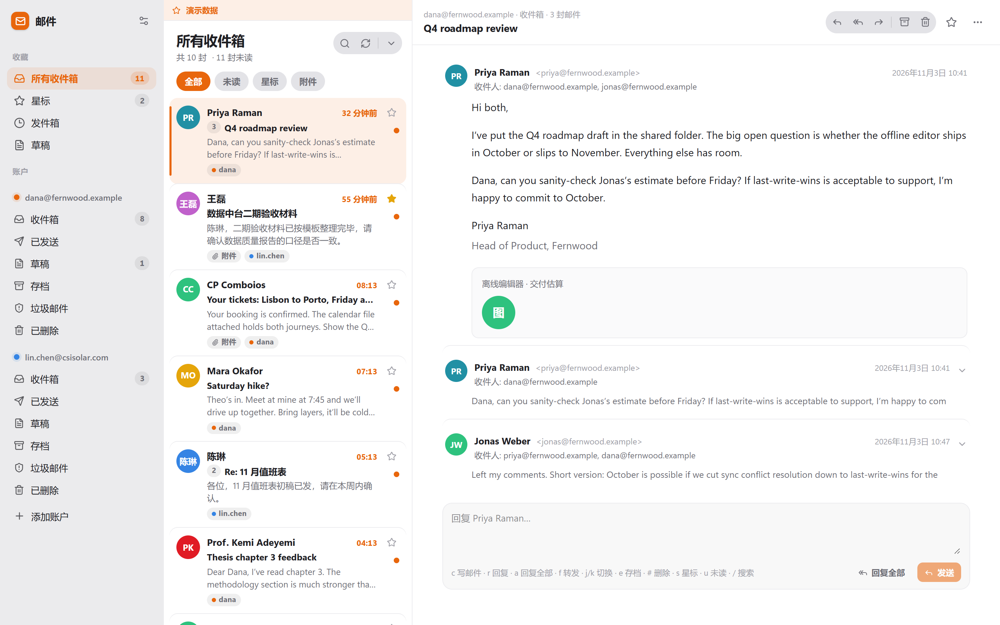

# DBX 邮件（dbx-mail）

本地优先的多账户邮件工作台，作为 **DBX 插件**运行。
邮件副本、正文、附件与草稿都缓存在本机 SQLite 与数据目录里，**离线也能读、能写、能排队发送**；
所有文件系统操作（附件落盘、`.eml` 导入导出、目录浏览、原始邮件缓存）都由 Rust Sidecar 完成，
插件页面本身没有文件系统与网络权限。

界面与信息架构参考开源邮件客户端 [Penguin Mail](https://github.com/t8y2/penguin-mail) 1.0.11，
按 DBX 插件体系重新实现（代码为独立编写，未复制其 Rust/GTK 源码）。

## 0. 安装

从 [Releases](https://github.com/mjj3610/dbx-mail/releases) 下载对应平台的
`com.mjj3610.mail-<版本>-<平台>.dbxp`（`windows-x64` / `linux-x64` / `linux-arm64` / `darwin-x64` / `darwin-arm64`，
由 CI 在各自原生 runner 上构建），或在 DBX 的插件商店里搜索「邮件 / DBX Mail」。
当前版本 **0.1.5**（五平台未签名包）。


## 1. 功能

| 模块 | 能力 |
| --- | --- |
| 账户 | IMAP/SMTP 多账户；8 种服务商预设（Gmail / Outlook / QQ / 腾讯企业邮 / 163 / 阿里云 / iCloud / Yahoo）按域名自动填服务器；手动改 host/port/加密方式；添加前测试连接；文件夹发现 |
| 密码 | 系统凭据库（Windows Credential Manager / macOS Keychain / Secret Service）；不可用时退化为 AES-256-GCM 本地加密文件（`secrets.key` + `secrets.bin`，Unix 0600） |
| 同步 | IMAP 增量同步：`UIDVALIDITY` 变化时重置文件夹、按 `last_uid` 拉新头、旗标双向同步（`pending_flags` 表避免服务器覆盖本地改动）；同步范围可选「主要文件夹 / 全部」；启动 45 秒巡检、可手动同步、可关自动同步 |
| 会话列表 | 按 `References`/`In-Reply-To`/`Message-ID` 归并会话，会话内计数与未读聚合；过滤（全部 / 未读 / 星标 / 附件）；跨账户「所有收件箱」；搜索主题、摘要、发件人、收件人与正文全文；分页加载 |
| 阅读器 | 会话内多封邮件折叠展开；正文由 `mail-parser` 解析后本地渲染；HTML 先经 DOMPurify 白名单清洗；**远程图片默认不加载**——挂载前就把 `src` 换成占位，不会自动向图床发起任何请求；用户点「显示图片」后由本地后端代理取回并转 data URL（SSRF 白名单 + 逐跳重定向复核，拒绝环回、内网与 CGNAT） |
| 附件 | 解析 `mail-parser` 的部件索引，按需从原始邮件取字节；保存时自绘目录选择器选目录、同名自动加序号不覆盖；25 MB 单文件上限（`mail/part` 30 MB） |
| 撰写 | 富文本（加粗 / 斜体 / 下划线 / 删除线 / 等宽 / 链接 / 引用 / 列表 / 清格式）；多收件人、抄送、密送；多账户切换发件人；签名自动插入；附件拖入或选择；`Ctrl/⌘ + Enter` 发送 |
| 草稿 | 每 4.5 秒自动存草稿；关闭时可选「存为草稿 / 放弃」；草稿箱可继续编辑，发送后自动删除 |
| 发件箱 | 立即发送也先入队（留 `undoDelay` 撤销窗口）；定时发送（10 分钟 / 1 小时 / 明早 9:00 / 自定义时间戳）；后台每 2 秒投递，失败累计次数并可重试；崩溃重启后把 `sending` 复位为 `queued` |
| 归档与删除 | 存档 / 垃圾 / 已删除 / 移动到指定文件夹；IMAP 侧优先 `MOVE`，不支持时退化为 `COPY + \Deleted + EXPUNGE` |
| 导入导出 | `.eml` 导出到选定目录（按主题截断命名、同名加序号）；`.eml` 导入到当前文件夹（本地建档、写正文与附件缓存） |
| 界面 | 三栏（侧栏 / 会话列表 / 阅读器）、按会话聚合、深浅色（跟随系统 / 手动）、列表密度、简中 / 英文、窄屏单栏、`j/k` `c` `r` `a` `f` `e` `#` `s` `u` `/` 快捷键 |
| 演示模式 | 地址后加 `?demo=1` 且无 Sidecar 时使用内存数据，用于没有邮箱时预览界面 |



## 2. 架构

```
┌──────────────── DBX 宿主（workbench iframe，CSP: connect-src 'none'）────────────────┐
│  React 19 + Zustand + Tailwind v4（单文件 bundle → ui/）                             │
│  window.dbxPlugin.invoke(method, params)  ── JSON-RPC 2.0 over stdin/stdout ──┐     │
└───────────────────────────────────────────────────────────────────────────────┼─────┘
                                                                                │
┌──────────────────────── Sidecar：backend（Rust / tokio）──────────────────────▼─────┐
│ main.rs     逐行读 JSON-RPC，握手 plugin/initialize，分发 30 余个方法               │
│ accounts.rs 服务商预设、账户增删改查、连接测试、文件夹发现                          │
│ imap.rs     async-imap + rustls（SSL/TLS 与 STARTTLS），UTF-7 文件夹名编解码         │
│ smtp.rs     lettre（SSL/TLS / STARTTLS / 明文），mail-builder 组装 MIME             │
│ mime.rs     mail-parser 解析、cid: 内联图转 data URL、附件与正文抽取、会话 key       │
│ sync.rs     增量同步、旗标双向、按需取正文、移动/删除、SMTP 投递 + APPEND 已发送     │
│ compose.rs  发件箱队列、撤销窗口、定时投递、草稿读写                                │
│ files.rs    目录浏览、附件保存、上传暂存、.eml 读写、同名去重                        │
│ net_guard.rs 出网白名单：图片代理的主机校验与逐跳重定向复核                          │
│ db.rs       SQLite（WAL）：11 张表、会话聚合查询、全文过滤                          │
│ secrets.rs  keyring → AES-GCM 本地加密兜底                                          │
│ tls.rs / stream.rs  进程级 rustls ClientConfig、Plain/TLS 流抽象                    │
└────────────────────────────────────────────────────────────────────────────────────┘
```

- 协议：DBX Plugin Protocol **v1**，`plugin/initialize` 返回 `protocolVersion: 1`，
  `plugin.id` / `plugin.version` 必须与 `manifest.json` 完全一致（否则宿主报
  `Sidecar identity or protocol does not match manifest`）。
- 清单 `permissions` 为空数组：宿主只接受 `host.network:<url>` 形式的网络权限，
  写 `host.copy` 之类会被判为 `Unsupported plugin Host API permission` 而拒绝加载。
  剪贴板/文件/网络都由 Sidecar 或页面自身完成。
- 前端不直接联网：远程图片、IMAP、SMTP 全部经由 Sidecar。

## 3. 数据与隐私

| 内容 | 位置 |
| --- | --- |
| 账户（不含密码）、文件夹、邮件头、旗标 | `<数据目录>/dbx-mail.db`（SQLite，WAL） |
| 正文缓存 | `dbx-mail.db` 的 `bodies` 表；原始邮件另存 `<数据目录>/raw/<account>/<mailbox>/<key>.eml` |
| 附件 | 不落库字节，只有 `attachments` 元数据；保存时从原始邮件解出直接写到用户选定目录 |
| 密码 | 系统凭据库；不可用时 `<数据目录>/secrets.bin`（AES-256-GCM，密钥 `secrets.key`） |
| 上传暂存 | `<数据目录>/tmp/`（撰写器附件先落这里，路径记入草稿） |
| 设置 | `dbx-mail.db` 的 `settings` 表（键值对） |

数据目录由宿主通过环境变量提供（`DBX_PLUGIN_DATA_DIR`），插件不写插件目录之外的位置。

## 4. 构建

前置：Node 20+、Rust stable（Windows 用 **gnu** 工具链：`stable-x86_64-pc-windows-gnu`，
MSVC 的 `link.exe` 常被 Git 的 `link` 抢占）、`cargo` 走镜像（`backend/.cargo/config.toml` 已配 rsproxy）。

```bash
npm install
npm run build          # vite → ui/（单文件 bundle，不可拆包）
npm run backend        # cargo build --release → backend/target/release/backend[.exe]
npm run sidecar-check  # 15 项协议冒烟测试（握手 / 设置 / 目录 / 列表 / 错误码）
npm run pack           # scripts/package.mjs → release/<id>-<version>-<当前平台>.dbxp（本地只能打当前平台）
```

**多平台包由 CI 产出**：`.github/workflows/plugin-release.yml` 调用
`t8y2/dbx` 的复用工作流，在 `ubuntu-24.04` / `ubuntu-24.04-arm` / `windows-2022` /
`macos-15-intel` / `macos-15` 上各构建一次，产物挂到对应 Release。
发版流程：改版本号 → 打 tag → **Publish release**（draft 不触发 `release: published`）→
等 5 个 job 绿 → 下载 `release-candidates.json` 生成商店候选。
带原生 Sidecar 的插件无法产出 universal 包，官方 CLI 会直接拒绝跨平台打包。

- `backend/rust-toolchain.toml` 固定 `stable-x86_64-pc-windows-gnu`：本机没有 MSVC Build Tools，
  默认 MSVC 工具链的 `link.exe` 又常被 Git 自带的 `link` 抢占。
- `npm run pack` 用本地打包器复刻官方 CLI 的产物格式（同样的目录布局、`checksums.json`、
  `artifact.json` 与改写后的 `manifest.json`）。之所以不用 `npm run pack:cli`：官方 CLI 以 `\\?\`
  前缀路径调用 cargo，MinGW 的 ld 无法处理，且没有跳过编译的开关。
- 若在装有 MSVC Build Tools 的机器上，`npm run pack:cli` 可直接使用。

本地预览界面（无宿主、无后端）：`npm run dev` 后访问 `http://localhost:5173/?demo=1`。

## 5. 目录结构

```
dbx-mail/
├─ manifest.json            # 插件清单（id / 版本 / 权限 / workbench 贡献）
├─ dbx-plugin.toml          # 打包配置（Rust backend + include 列表）
├─ backend/                 # Rust Sidecar（13 个模块 + 18 个单元测试）
├─ src/                     # 前端
│  ├─ lib/{bridge,rpc,demo,i18n,format,html}.ts
│  ├─ stores/{mail,composer,ui}.ts
│  └─ components/{Sidebar,ThreadList,Reader,Composer,SettingsDialog,AccountWizard,DirPicker,ShortcutsDialog}.tsx
├─ ui/                      # 构建产物（被宿主注入）
├─ scripts/sidecar-check.mjs
├─ screenshots/             # 文档截图
├─ docs/                    # 版本与部署说明
└─ licenses/                # 第三方许可证副本
```

## 6. 已知限制

- 只支持 IMAP/SMTP（不含 POP3、JMAP、Exchange 直连）。
- 富文本编辑器使用 `document.execCommand`，是本机 Chromium 的行为，功能足够但已废弃；后续可换可编辑层。
- 会话聚合依赖邮件头的 `References` / `In-Reply-To`，主题相同但无引用头的邮件不会合并。
- 搜索为 SQLite `LIKE`（不是 FTS5）：几千封邮件的本地缓存下足够快，超过十万封需要换 FTS。
- 附件不落库，只在需要时从原始邮件重新解出；若原始 `.eml` 被手工删除，附件将无法再取。
- 日历（`.ics`）只作为附件展示，不解析为日程。

## 6.1 服务商兼容性处理

中文文件夹名（如「已发送」「草稿箱」「垃圾邮件」）在 IMAP 线上协议里必须转成 **modified UTF-7**（[RFC 3501 §5.1.3](https://www.rfc-editor.org/rfc/rfc3501#section-5.1.3)），服务器只认 `&XfJT0ZAB-` 这种形式。本插件的处理规则：

- 数据库与界面里统一存**解码后的可读名字**；只在向服务器发 `SELECT` / `EXAMINE` / `STATUS` / `COPY` / `MOVE` / `APPEND` 前编码（`imap::encode_utf7`）。
- 若编码版被服务器拒绝，自动退回**原始名字**再试一次，兼容返回原始 UTF-8 名字的少数服务器。
- 能力列表含 `ID` 时先发 [RFC 2971](https://www.rfc-editor.org/rfc/rfc2971) 报到（`name` / `version` / `vendor`）。163、126 等国内邮箱不做这一步会以 `Unsafe Login` 拒绝 `SELECT`，表现为「连接测试通过但同步报错」。

## 6.2 正文渲染

邮件 HTML 先过 DOMPurify 白名单，再进入渲染策略（`src/lib/html.ts`）：

| 内容 | 处理 |
| --- | --- |
| 远程图片 | 默认拦截：**挂载前**就把 `src` 换成 1×1 透明 GIF + 斜纹占位框（按原始 `width`/`height` 定尺寸），原地址存进 `data-remote`，点「显示图片」后经本地代理取回转 data URL；声明尺寸 ≤2px 的按跟踪像素直接隐藏 |
| CSS 背景图 | `background-image: url(http…)` 与 `background="…"` 同样先拦后取 |
| `cid:` 内嵌图 | 后端解析时已转成 data URL，不需要联网 |
| 邮件 `<style>` | 整段抽出 → 所有选择器加 `.mail-html` 前缀（`@media` 递归）→ 去 `@import` → `position:fixed` 落回文档流 → 以 `textContent` 注入，避免邮件样式改到应用自身 |
| 排版语义 | Tailwind preflight 会清零 `*` 的 margin、去掉列表符号、把 `h1~h6` 拉平、把 `img` 变块级；`.mail-html` 内已逐项还原 |
| 深色模式 | 摘掉写死的 `color` / `background` / `border-color`（内联与 `<style>` 都摘），交给主题变量 |

- 「显示图片」当前是**会话级**开关：点一次之后，本会话打开的其它邮件也会自动取图。
  按邮件/按发件人的粒度留待后续版本。

回归脚本（需要 demo 富格式样例，`?demo=1&rich=1`）：

```bash
node scripts/render-check.mjs        # 拦截态 / 放开态截图与 DOM 断言
node scripts/render-check-dark.mjs   # 深色模式主色检查
node scripts/render-check-scroll.mjs # 长正文可滚动、不横向裁切（?rich=2 固定 700px 模板）
node scripts/render-check-folder.mjs # 自定义文件夹按需同步、同角色文件夹不重名
node scripts/sanitize-check.mjs      # 注入回归：阅读器与回复引用两条路径（?evil=1）
```

`sanitize-check` 用的是 `?demo=1&evil=1` 挂的恶意样例（``、`javascript:` 链接、
`<iframe>`、`<svg onload>`、`<script>`、`<form>`、CSS 远程 `url()`），每条载荷都会写
`window.__dbxXss`，断言的是「标记没出现」而不是「标签被删掉」，改标签名绕不过去。

这些脚本通过 `scripts/browser.mjs` 解析 playwright 与 Chromium，不再写死本机路径。
自动探测失败时用环境变量指定：

```bash
PLAYWRIGHT_CORE=/path/to/playwright-core/index.mjs \
CHROMIUM_PATH=/path/to/chrome \
node scripts/sanitize-check.mjs
```

## 6.3 同步范围

- 默认 `primary`：只同步收件箱 / 已发送 / 草稿 / 存档；自定义文件夹（如「12306」「通行费」）不进同步队列。
- 打开一个从未同步过的文件夹（`uidValidity = 0`）会自动同步一次；列表空状态提供「同步此文件夹」按钮，
  头部刷新按钮在打开具体文件夹时也只同步该文件夹。
- 需要一次拉全，把「设置 → 同步范围」改成「全部文件夹（含自定义，不含垃圾/已删除）」。

## 7. 许可

- 本插件：GPL-3.0-or-later（见 `LICENSE`，FSF 标准文本，未作任何改动）。
- 版权归属：Copyright (C) 2026 mjj3610，见 `NOTICE`。
- 第三方组件、许可证全文与传递依赖中的非 MIT/Apache 组件见 `THIRD-PARTY-NOTICES.md` 与 `licenses/`。
